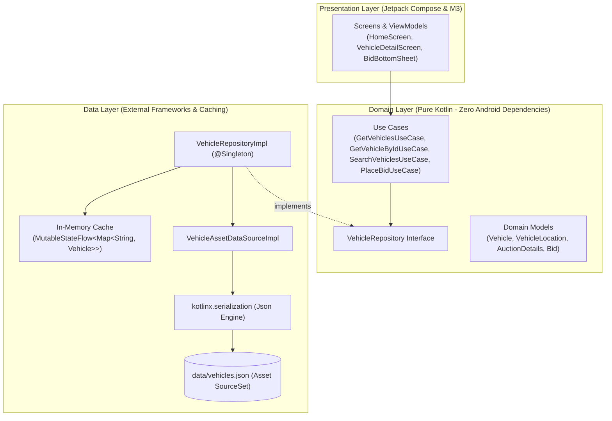
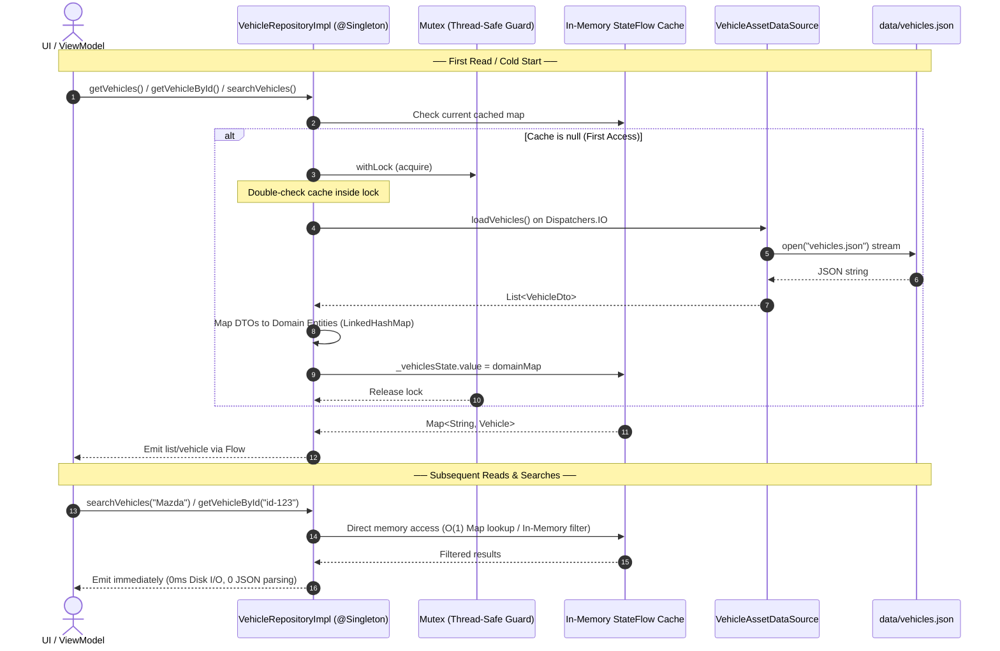
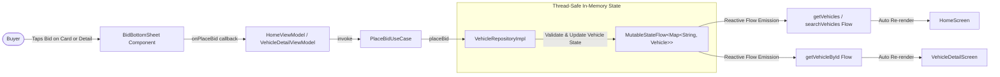

# The Block — Technical Documentation & Architecture

This document details the architectural foundation, data pipeline, caching mechanisms, and design decisions behind **The Block** native Android buyer-side vehicle auction application.

---

## 1. High-Level System Architecture

The application strictly adheres to **Clean Architecture** with inward-pointing dependencies, ensuring total separation of concerns, testability, and independence from external frameworks:



---

## 2. "Read Once & Cache" Strategy

### The Problem
The static dataset (`data/vehicles.json`) contains ~200 vehicle listings and is roughly 288 KB. Repeatedly opening file input streams and deserializing JSON on screen transitions or during search keystrokes causes:
* Excessive disk I/O on Android storage threads
* Memory churn and Garbage Collection (GC) pauses
* Sluggish UI response times and dropped frames

### The Solution: Thread-Safe In-Memory Singleton Cache
The dataset is loaded and parsed **exactly once** during the app lifecycle. Subsequent reads, searches, and lookups execute entirely in-memory at near-zero latency.



### Performance Characteristics

| Operation | Implementation | Time Complexity | Disk I/O |
|---|---|---|---|
| **First Load** | `ensureLoaded()` with `Mutex` + `kotlinx.serialization` | $O(N)$ (one-time ~20-40ms) | Read once |
| **Read All** | Emits `map.values.toList()` from in-memory cache | $O(1)$ emission | None |
| **Get by ID** | Key lookup on `Map<String, Vehicle>` | $O(1)$ | None |
| **Search Query** | In-memory predicate across make, model, year, trim, vin | $O(N)$ memory scan (~0.1ms) | None |
| **Place Bid** | Copy-on-write update in `Map<String, Vehicle>` | $O(1)$ | None |

---

## 3. Reactive Live Bidding & State Propagation

When a buyer places a bid, the vehicle's state must immediately update across the application without reloading the raw data source.

Because `VehicleRepositoryImpl` stores the in-memory cache inside a `MutableStateFlow<Map<String, Vehicle>>`, mutating a vehicle emits a new snapshot to all active collectors across the application in real time:



### Bid Placement Rules
* **Validation**: The bid amount must be strictly greater than the vehicle's `currentBid` (or `startingBid` if no bid is present). This is enforced inside `VehicleRepositoryImpl.placeBid(...)`.
* **Atomic State Mutation**: The repository produces an updated copy of the `Vehicle` (`currentBid = amount`, `bidCount = bidCount + 1`) and stores it back in the map under a `Mutex` lock.
* **Result Return**: `VehicleRepository.placeBid(...)` and `PlaceBidUseCase.invoke(...)` return `Result<Vehicle>`, allowing ViewModels and UI to handle success or validation failure gracefully.
* **Reactive Fan-out**: Any screen observing `getVehicles()`, `searchVehicles(...)`, or `getVehicleById(...)` receives the updated state emission immediately.

---

## 4. Gradle Asset Packaging Decision

### Approach: Zero-Duplication SourceSet Linking
Rather than manually copying `data/vehicles.json` into `app/src/main/assets/vehicles.json`, we configured the Android Gradle plugin `sourceSets`:

```kotlin
// app/build.gradle.kts
android {
    sourceSets {
        getByName("main") {
            assets.directories.add("../data")
        }
    }
}
```

### Why this approach?
1. **Single Source of Truth**: The original `data/vehicles.json` at the root of the challenge repository is packaged directly into the APK assets during Gradle build.
2. **No Git Redundancy**: Avoids checking in identical ~288 KB JSON files in multiple locations.
3. **Seamless Updates**: If the challenge data changes or gets extended, the app picks it up immediately upon rebuild.

---

## 5. Layer Directory Breakdown

```
app/src/main/java/com/anenha/block/
├── domain/                      # DOMAIN LAYER (Pure Kotlin, zero Android UI dependencies)
│   ├── model/
│   │   ├── Vehicle.kt           # Business entity (specs, pricing, condition, location)
│   │   └── Bid.kt               # Bid entity (vehicleId, amount, timestamp)
│   ├── repository/
│   │   └── VehicleRepository.kt # High-level contract returning Kotlin Flow
│   └── usecase/
│       ├── GetVehiclesUseCase.kt
│       ├── GetVehicleByIdUseCase.kt
│       ├── SearchVehiclesUseCase.kt
│       └── PlaceBidUseCase.kt
│
├── data/                        # DATA LAYER (Data sources, DTOs, caching)
│   ├── datasource/
│   │   └── VehicleAssetDataSource.kt # Reads asset stream on Dispatchers.IO
│   ├── dto/
│   │   └── VehicleDto.kt        # kotlinx.serialization DTO matching JSON schema
│   ├── mapper/
│   │   └── VehicleMapper.kt     # VehicleDto.toDomain() extension
│   └── repository/
│       └── VehicleRepositoryImpl.kt # @Singleton with in-memory StateFlow cache
│
├── features/                    # FEATURE SLICES (Jetpack Compose + ViewModel)
│   ├── home/                    # Auction feed, instant search, and live bidding triggers
│   │   ├── HomeScreen.kt
│   │   ├── HomeViewModel.kt
│   │   ├── HomeUiState.kt
│   │   └── HomeUiEvent.kt
│   └── detail/                  # Detailed telemetry, specs, condition report, and sticky bid bar
│       ├── VehicleDetailScreen.kt
│       ├── VehicleDetailViewModel.kt
│       └── VehicleDetailUiState.kt
│
├── ui/                          # SHARED PRESENTATION FOUNDATION
│   ├── theme/                   # Material 3 ColorScheme, Typography, Shapes, Spacing
│   ├── components/              # Reusable design atoms (VehicleCard, VehicleBadge, BidBottomSheet)
│   ├── navigation/              # Destinations, NavHost setup (BlockDestinations, BlockNavHost)
│   └── util/                    # Presentation formatters (FormatUtils)
│
└── di/                          # DEPENDENCY INJECTION (Dagger Hilt)
    ├── IoDispatcher.kt          # @IoDispatcher qualifier
    ├── DataModule.kt            # Provides Json parser, CoroutineDispatchers, AssetDataSource
    └── RepositoryModule.kt      # @Binds VehicleRepositoryImpl -> VehicleRepository
```

---

## 6. Walkthrough & Evaluation Talking Points

When presenting in the **OPENLANE Walkthrough** (per [`WALKTHROUGH.md`](file:///c:/Users/Ana/Projects/block/the-block/WALKTHROUGH.md)):

1. **Architecture & Clean Boundaries**:
   * *Talking Point*: Point out that the `domain` layer has zero imports from `android.*` or `androidx.compose.*`. All business models, validation rules, and use cases are pure Kotlin.
2. **Performance & Memory Efficiency**:
   * *Talking Point*: Explain the "Read Once & Cache" strategy. Discuss how it avoids repetitive I/O, supports instantaneous search over 200 vehicles, and enables $O(1)$ vehicle lookups by ID.
3. **Interactive Bidding & Reactive State**:
   * *Talking Point*: Demonstrate how placing a bid updates `_vehiclesState` inside `VehicleRepositoryImpl`, automatically flowing through Kotlin `Flow` to both the detail view and inventory list without requiring a backend database or network reload.
4. **Pragmatic Gradle Config**:
   * *Talking Point*: Show the `sourceSets` asset link that packages `../data/vehicles.json` without file duplication.
